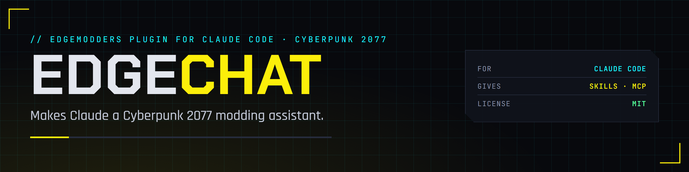

<p align="center">
  
</p>

<p align="center">
  <a href="https://edgemodders.github.io/EDGEchat/"></a>
  
  
  
  <a href="LICENSE"></a>
</p>

Chat with EDGE in [Claude Code](https://code.claude.com/docs/en/overview). EDGEchat is a plugin that makes Claude a Cyberpunk 2077 modding assistant. Skills that know the game's files and frameworks, the EDGE tools that read the game's archives and the running game, and commands such as "start a new mod", in one install. It works in [EDGEkit](https://github.com/Edgemodders/EDGEkit), in VS Code, and in a terminal.

EDGEchat is not an agent: it connects Claude Code to EDGE while you build mods. [REDagent](https://github.com/Edgemodders/REDagent) is the agent in the game, with its own window and tools.

**[Docs](https://edgemodders.github.io/EDGEchat/)** · [Design](https://edgemodders.github.io/EDGEchat/design.html) · [EDGEkit](https://github.com/Edgemodders/EDGEkit) · [REDagent](https://github.com/Edgemodders/REDagent)

> [!NOTE]
> **Status: P1, skeleton.** It installs and connects the servers, with two commands (`/edge:setup`, `/edge:init-project`). No modding skills yet. Windows only for the servers.

## Install

In Claude Code (the CLI, or `/plugins` in the VS Code extension and EDGEkit):

```
/plugin marketplace add Edgemodders/EDGEchat
/plugin install edge@edgemodders
```

Then run `/edge:setup`. It checks the servers and says what is missing. The plugin asks for four settings, all optional: REDnode's token (from the game's launcher, **F10**, **REDNODE** tab, **Copy setup**), the game folder and `REDbridge.exe` (not needed if REDcode is set up in VS Code), and EDGEdeck's library folder (only if you moved it from the default). Change them later with `/plugin configure edge@edgemodders`, or the gear on the plugin in VS Code.

The servers need Windows and Node.js 20 or newer; the game with REDnode for `rednode`; the .NET 10 runtime and REDbridge 0.8.0 or newer for `redcode`. If you added `rednode`, `redcode` or `edgedeck` by hand before, remove that copy (`/edge:setup` explains how).

The plugin is called `edge`, so commands stay short. `edge` and `edgemodders` are working names until the first release.

## What it will give Claude

| Part | What |
|---|---|
| Skills | Modding knowledge, loaded only when a task needs it: the game's folders and frameworks, WolvenKit projects, archives and CR2W, TweakXL, ArchiveXL, redscript, CET, REDnode mods |
| MCP servers | [REDnode](https://edgemodders.github.io/REDnode/mcp.html)'s kernel server (the running game), [REDcode](https://edgemodders.github.io/REDcode/mcp.html)'s `redcode-mcp` (the game's files, offline) and [EDGEdeck](https://github.com/Edgemodders/EDGEdeck)'s `edgedeck-mcp` (mods and deploys); EDGEmat's and the other EDGE tools' as they are published, with every setting they need in the plugin's one form |
| Commands | Set up and check the connections, start a mod, check a mod, write a project's `CLAUDE.md` |

Made by EDGEmodders. Not affiliated with Anthropic or CD PROJEKT RED. Claude and Claude Code are trademarks of Anthropic; Cyberpunk 2077 is a trademark of CD PROJEKT.

## License

MIT. See [LICENSE](LICENSE).
